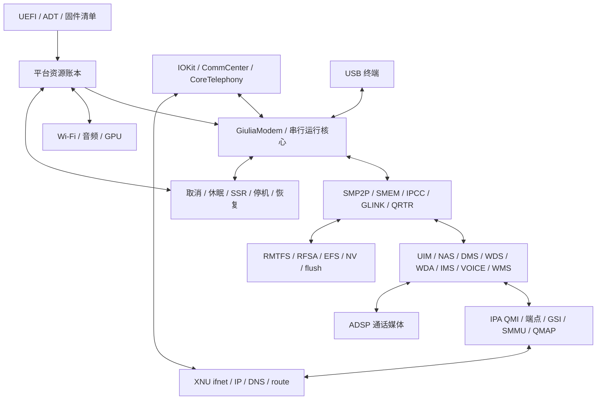

# giulia 基带统一框架

目标平台是 SM8650 / giulia，系统输入固定为 20H392。本文是各实现共同遵守的跨层契约；
寄存器和消息细节分别由板级映射、协议映射和 Apple ABI 证据提供。
实现顺序是总体框架、构建与系统接入、完整机制、贯穿场景。任何局部结果都不独立代表蜂窝可用。

## 三条路径与共同生命周期

同一运行核心维护生命周期、每个订阅、每个数据承载、IMS、呼叫、短信和持久化状态。
控制面应答、硬件动作完成、业务成立是三种不同的事件，不能由提交动作返回 0 互相替代。
所有外部入口最终进入同一串行队列，回调不允许重入核心。

服务命令队列保存接受时的 epoch、lifecycle、订阅和承载 generation；worker 执行前复核，
跨代次返回 STALE。START 同样绑定接受时的 epoch；STOP 面向当前所有者并取消尚未执行的
START 与自动启动。常驻按值诊断入口及热加载边界见[常驻控制](MODEM_HOTLOAD.md)
（[English](MODEM_HOTLOAD.en.md)）。

## 公共接口

`gmr_init/start/submit/event/tick/cancel/snapshot` 是平台无关核心入口。
`gmr_action` 描述要执行的动作，底层 `submit` 只承诺接受动作；必须收到匹配的
完成事件后才能推进状态。动作和事件关联运行代次、操作号、订阅代次、承载代次、服务地址代次及事务。
接口结构和枚举由 `giulia_modem_contract.h` 定义，ABI 初始版本为 1。

provider 的 `submit` 有效正值拒绝表示未接受且未发出硬件操作；worker 通过 `gmr_reject` 精确退休该动作，
不合成未知硬件完成。已提交后发生错误必须通过 `poll` 回报。所有已有资源仍按失败策略保留，
不能根据入队失败把部分启动复位为 OFF。

| 接口边界 | 生产者 → 消费者 | 必须保持的语义 |
| --- | --- | --- |
| 资源 | 核心 → 平台 broker → 实际 provider | owner/epoch/token 标识租约；软件租约不冒充硬件访问授权 |
| 固件 | 启动动作 → 固件/PAS provider → 生命周期事件 | 固件身份、加载区间、PAS、DSM 转交、ready 属于同一代次 |
| 通信 | IRQ/GLINK → QRTR 路由 → QMI 核心 | 先验证来源和长度；旧服务地址/旧事务不得更新当前状态 |
| 持久化 | 远端请求 → 受限后端 → flush 确认 | 接受、写入、持久化完成分别记录；确认不能先于持久化 |
| 数据 | WDS/IPA 状态 → 网络接口 → DMA 完成 | bearer、订阅、mux、端点、IOVA、完成代次一致 |
| 媒体 | IMS/VOICE → 音频 provider → 呼叫状态 | 网络呼叫和媒体就绪分别确认；挂断排空媒体和承载 |
| Apple | 原用户态 ABI → 兼容适配 → 统一命令/快照 | selector/结构/通知取自相同 build；不得产生独立连接状态 |
| 终端 | 命令解析 → 核心请求队列 | 使用同一状态和取消规则；状态查询不重新读取或占有硬件 |

## 生命周期和故障闭环

生命周期包含关闭、资源准备、固件启动、通信建立、控制服务可用、停止、休眠、恢复和隔离。
订阅与业务状态并行维护，数据承载成功不自动开启 IMS、通话或短信状态。
启动顺序为资源、存储后端、IPC_PREPARE、固件启动、IPC 握手；反向文件服务在固件等待 ready 前即可接收请求。
具体服务出现顺序按事件处理，不假定所有服务同时公布。

每个 bearer 的会话代次在普通断开后仍保留，重连只会递增；运行代次和 WDS 服务地址不变也
不能复用旧 DMA 身份。RX 必须携带 DMA_CONFIGURE 时保存的不可变绑定，禁止按当前快照
给旧 ring 完成补写新身份。断开先退休本地 TX 和 RX 回执，再由 DATA_REMOVE 确认网络撤销、
RX 排空、TX 排空和 DMA 停止四项，随后完成 WDS stop 才允许重连。IMS 注册要求当前代次
已有 UP 承载，STARTING、STOPPING 或结果不确定的承载不满足该条件。

当前框架每个订阅只容纳一条在途短信。SUBMITTING、ACCEPTED 和 UNCERTAIN 阶段返回 BUSY，
保留原消息标识；只有确定完成或失败后才能提交下一条。取消和超时不触发自动重发。
协议字段映射覆盖范围不代表多短信并行队列已经实现。

换卡和主动关闭 RF 在任一槽存在上述活动短信时返回 BUSY。换卡/RF 操作在途时拒绝新增订阅业务，
避免在旧订阅上发出操作后被切换完成清除。SIM 改变或查询发现卡不再 READY 时，活动短信触发有序停机；
SSR 将 SUBMITTING/ACCEPTED 置为 UNCERTAIN 并保留 `sms_id`。没有持久化对账接口时不得清零后重发。

发生 fatal、watchdog、服务退出或 SSR 后，先停止接受新业务并失效旧请求，随后按依赖
排空存储和 DMA、关闭传输、停止远端、回收内存归属和资源。只有明确完成才能释放租约。
部分成功或不确定结果保留在账本中；再次启动不能通过清零状态绕过未完成的回收。
基带恢复不能撤销 Wi-Fi、音频或 GPU 仍持有的电源、带宽、IRQ 或地址空间。
SSR 的有序停机尚未完成时，外部 STOP 取消自动重启并复用当前排空过程，避免服务停机
等待线程退出期间又启动基带。

全局 DATA_DRAIN 与单承载 DATA_REMOVE 一样，要求实际确认网络撤销、RX 排空、TX 排空和物理 DMA 停止
四项，成功状态码本身不够。IPC_STOP 可以关闭 GLINK 业务，但 FIRMWARE_STOP 仍需 SMP2P/sysmon、SMEM
和 stop-ack IRQ；这些基础设施不能提前释放。非 ONLINE 状态拒收新 DATA_RX，worker 在实际 ifnet 投递前
再次核对代次和 RX 回执，避免同轮动作失败后继续投递旧包。

## 全局资源仲裁

`gpr` 以资源种类、控制器域、对象/子对象 ID 及物理区间命名资源，使用 owner、epoch
和带序列号 token 防止释放旧租约。IPCC 整个 aperture 的独占与 host 的 client/signal
共享是两个层级；QMP/SCM 未决事务保持排他。SMMU 必须同时包含实例和 SID，GSI channel
必须包含执行环境。共享投票按 owner 聚合，释放一个 owner 不得清除其他投票。

现有 GPU/音频/Wi-Fi 入口保留兼容签名，通过公共 broker 协调与 modem 的冲突。
GPU 已有 aperture/fence 排他规则继续成立。该仲裁不代替 RPMh、SCM、SMMU 或远端停止结果。
Wi-Fi 和音频的平台仲裁独立于 GPU 是否编入。AOP 的 IPCC `0/0` 允许共享映射成员，
但每次完整 QMP 会话必须另持有唯一 `0x0c300000/0x400` 邮箱租约；未决会话不释放。
其他相同 IPCC channel 不共享，整个 GPU aperture 仍与所有重叠 host 成员互斥。

## 系统与产物契约

统一 modem 声明包含 schema、board、system_build、runtime_abi、mode、公共 broker、原生
provider 和 Apple ABI 摘要。诊断模式保留原用户态禁用策略；managed 模式必须绑定实际
provider、ABI、固件/资源交接、ADT 和根卷策略。模式不是人为设置“已连接”的开关。

构建生成 `modem-config.json` 与 `giulia_modem_build.h`，把固件清单、板级资源、Apple ABI
及生产核心源码摘要编入同一内核标记。rebase、payload 生成、解包核验和最终打包都比较这个
标记；不能把更新后的旁车 JSON 配给旧内核，也不能因文件名相同而接受另一套固件资料。

原始 20H392 的两个 CommCenter 作业使用同一 Label，依赖 ADT `baseband` 节点互斥选择。
启动策略与音频兼容选项分离。打包和反向核验使用同一份声明；修改声明、kernel、ADT 或
root policy 中任何一项都必须使不一致的产物被拒绝。

## 统一验收

验收需要完整构建、产物契约核验和实机记录，沿资源交接、服务发现、存储、SIM、注册、数据、媒体、休眠、SSR、恢复和关机覆盖完整生命周期。历史主机场景不能单独给出系统完成结论。

详细机制清单记录每条边的生产者、消费者、时序、失败、恢复、系统效果和固定来源。
有证据的不适用能力保留原因；尚未解析的 ABI 必须继续追踪具体输入，不能填入猜测常量。
